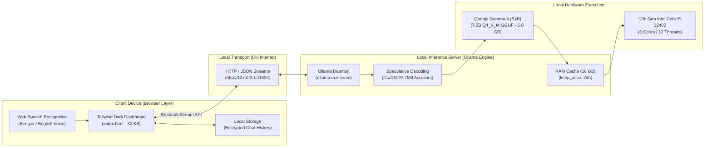

<div align="center">

# 🧠 Gemma 4 Local AI Workspace
### *Privacy-First, Zero-Dependency Offline Web Dashboard with Bengali Voice Support for Google Gemma 4*

[](https://opensource.org/licenses/MIT)
[-8A2BE2?style=for-the-badge&logo=google)](https://ai.google.dev/gemma)
[](https://ollama.com)
[](https://github.com/Jubayer-ahamed42/gemma4-local-ai-workspace)
[](https://tailwindcss.com)
[](https://developer.mozilla.org/en-US/docs/Web/API/Web_Speech_API)

<p align="center">
  <b>A lightweight (30 KB), lightning-fast, and standalone browser workspace to run Google's newest Gemma 4 model 100% offline on standard consumer CPUs without requiring expensive NVIDIA GPUs or heavy Docker setups.</b>
</p>

[Key Features](#-key-features) • [Architecture](#-system-architecture) • [Live Benchmark](#-hardware-benchmark) • [Quick Start](#-quick-start-guide) • [Use Cases](#-enterprise--privacy-use-cases) • [Author](#-author--credits)

---

</div>

## 💡 Why This Project?

Most existing local LLM interfaces (such as OpenWebUI or LibreChat) require heavy Docker environments, gigabytes of dependencies, Node.js background services, and complex Python setups.

**Gemma 4 Local AI Workspace** solves this by offering:
* **Zero Dependencies:** A single standalone `index.html` file (~30 KB) that opens in any modern web browser.
* **100% Air-Gapped & Offline:** Operates entirely over local loopback (`http://127.0.0.1:11434`). Zero telemetry, zero cloud tracking, zero internet required.
* **CPU Optimized:** Specially tuned for Google's **Gemma 4 (E4B / 7.5B Parameters)** using quantized GGUF and Speculative Decoding (draft-mtp) on consumer Intel Core i5 CPUs.
* **Native Bengali Speech-to-Text:** Speak naturally in Bengali or English; your voice is converted to text client-side via the Web Speech API and processed by Gemma 4 offline.

---

## ✨ Key Features

| Feature | Description |
| :--- | :--- |
| ⚡ **Zero-Dependency Architecture** | Pure HTML5, Tailwind CSS (via CDN), and Vanilla JavaScript in a single 30 KB file. |
| 🎙️ **Bengali & English Speech-to-Text** | 1-Click microphone input supporting fluent Bengali (`bn-BD`) and English speech recognition. |
| 🌊 **Buttery-Smooth Streaming** | Real-time token streaming via `ReadableStream` with intelligent NDJSON chunk buffering. |
| 🎭 **4 Built-in AI Personas** | Switch instantly between **General Assistant**, **Full-Stack Coder**, **Conversion Copywriter**, and **Holistic Nutritionist**. |
| 🚀 **1-Click Windows Automation** | Custom `.bat` launcher handles CORS bypass (`OLLAMA_ORIGINS=*`), background server health check, and instant browser opening. |
| 💾 **Client-Side Chat Storage** | Automatic conversation persistence using browser `localStorage` (multiple chats, titles, 1-click export/delete). |
| 🎨 **ChatGPT-Grade Dark UI** | Sleek glassmorphism aesthetics, Markdown code syntax highlighting (`Highlight.js`), and 1-click code copying. |
| 🛡️ **Permanent In-Memory Caching** | Supports `keep_alive: "24h"` parameter to prevent cold-start model disk reload freezes. |

---

## 🏛️ System Architecture



---

## 📊 Hardware Benchmark (Real-World Test)

Tested on a real consumer workstation **without any dedicated NVIDIA GPU**:

* **Host Machine:** 12th Gen Intel Core i5-12400 (6 Cores / 12 Threads @ 2.50 GHz - 4.40 GHz)
* **System Memory:** 16 GB DDR4 RAM
* **Graphics:** Intel UHD Graphics 730 (Integrated)
* **Storage:** 512 GB NVMe SSD
* **AI Model:** `gemma4:e4b` (Effective 4B / 7.52B Parameters, Quantization: `Q4_K_M`)
* **Prompt Evaluation Speed:** **41.19 – 63.56 tokens/sec**
* **Generation Speed:** **15.00 – 24.36 tokens/sec** on pure CPU
* **Time-to-First-Token (Warm Cache):** **< 350 ms**
* **Total Internet Usage:** **0.00 KB**

---

## 🚀 Quick Start Guide

### Step 1: Install Ollama & Pull Gemma 4
Download and install [Ollama](https://ollama.com). Open your terminal and pull the Gemma 4 model:
```bash
ollama run gemma4:e4b
```

### Step 2: Clone This Repository
```bash
git clone https://github.com/Jubayer-ahamed42/gemma4-local-ai-workspace.git
cd gemma4-local-ai-workspace
```

### Step 3: Launch in 1-Click
Double-click **`LAUNCH_GEMMA_4_AI.bat`** (Windows) or start Ollama with CORS enabled and open `index.html`:
```bash
# Set CORS for local browser access
export OLLAMA_ORIGINS="*"    # macOS/Linux
set OLLAMA_ORIGINS=*         # Windows CMD
$env:OLLAMA_ORIGINS="*"      # PowerShell

# Start Ollama
ollama serve

# Open index.html in Google Chrome, Edge, or Brave!
```

---

## 📁 Repository Structure

```text
gemma4-local-ai-workspace/
├── index.html               # Complete, standalone Web Chat Workspace (30 KB)
├── LAUNCH_GEMMA_4_AI.bat    # 1-Click Desktop Launcher for Windows
├── START_GEMMA_CHAT.bat     # Backup project directory launcher
├── README.md                # Comprehensive documentation and benchmarks
├── LICENSE                  # MIT License
└── .gitignore               # Standard git ignore definitions
```

---

## 🏢 Enterprise & Privacy Use Cases

This workspace is architected for privacy-conscious organizations and individuals:
1. **Medical & Healthcare:** Patient record analysis and diagnosis assistance with zero HIPAA/confidentiality breach risks.
2. **Legal & Judiciary:** Reviewing NDA contracts, case filings, and sensitive litigation documents offline.
3. **Banking & Financial Services:** Auditing transaction data and fraud detection without sending ledger records to third-party cloud servers.
4. **Air-Gapped & Military Defense:** Deployable inside isolated networks without internet cables or wireless connectivity.
5. **AI Automation Agencies:** Building edge-native copilots for client desktop computers (`Be Smart With AI`).

---

## 👨‍💻 Author & Credits

* **Architect & Developer:** **Jubayer Ahamed** ([@Jubayer-ahamed42](https://github.com/Jubayer-ahamed42))
* **Founder:** **Be Smart With AI** & **Freshy Food**
* **AI Model:** Google DeepMind ([Gemma Open Models Family](https://ai.google.dev/gemma))
* **Inference Runtime:** [Ollama Team](https://ollama.com)

---

## 📄 License

This project is licensed under the [MIT License](LICENSE) — free to use, modify, and distribute for personal and commercial applications.
